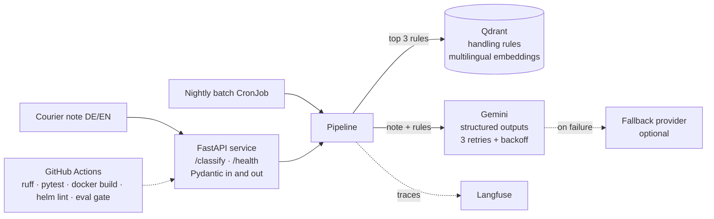

# Shipment Exception Copilot

An LLM service that triages messy courier exception notes, written in German, English or a mix of both, into a validated record: **category, urgency, language, English summary and a recommended next action**. Each action is taken from handling rules retrieved with RAG and cited by `rule_id`.

> *"Zolldokumente fehlen, Paket am Hub LEJ"* → `customs_hold` · `high` · `de` · *"Customs documents are missing; the parcel is at the hub."* · rule `R05`: request the commercial invoice from the sender within 24 hours.

Built as a portfolio project to practise taking an LLM application from prototype to production: structured outputs, retrieval, evaluation, observability, containers, Kubernetes and CI.

**All data in this repository is synthetic.** No real customer or company data is used.

---

## Architecture



| Component | Role |
|---|---|
| **FastAPI + Pydantic** | `/classify` and `/health`; request and response validation |
| **Gemini** (OpenAI-compatible API) | Structured outputs: the model must return the Pydantic schema |
| **Retries and failover** | 3 attempts with exponential backoff per provider, then the next provider; all failing returns HTTP 502 |
| **Qdrant + fastembed** | RAG over handling rules; a multilingual embedding model matches German notes to English rules |
| **Langfuse** | One trace per note: retrieval plus LLM call, with latency and tokens |
| **Docker / docker-compose** | API and Qdrant with one command |
| **Kubernetes (kind) + Helm** | Deployment with readiness and liveness probes, Service, nightly batch CronJob, persistent volume |
| **GitHub Actions** | Lint, tests, image build and Helm lint on every push; manual LLM evaluation as a quality gate |

---

## Evaluation

The model is graded against labels I wrote by hand using written [labeling guidelines](data/README.md). Category and urgency are scored separately.

### Development set (108 notes): what each change did

| Version | Change | Category | Urgency | p95 latency |
|---|---|---|---|---|
| v1 | Baseline prompt | 87.0% | 61.1% | 3.8 s |
| v2 | Category definitions and tie-break rules in the prompt | 96.3% | 61.1% | 6.9 s |
| v3 | 3 labels fixed that contradicted the written rules | 99.1% | 63.0% | 4.6 s |
| v4 | Concrete urgency rubric matching the guidelines | 98.1% | 87.0% | 3.2 s |
| v4 in CI | Same as v4, run in GitHub Actions | 97.2% | 87.0% | 9.3 s |

- **v1 → v2 uses identical labels**, so the gain comes from the prompt alone. The model wasn't wrong; it was under-specified.
- **Urgency didn't move in v2.** An error breakdown showed the rubric contradicted my own labels (it called every failed attempt "medium"). Rewriting it with concrete examples raised urgency accuracy from 61% to 87%.
- **99.1% → 98.1% with no change** shows run-to-run noise even at temperature 0. The CI run's lower score is entirely its 2 failed calls, which count as wrong.

### Held-out test set (42 notes, never used for tuning)

| Category | Urgency | Median latency | Failed calls |
|---|---|---|---|
| 78.6% | 69.0% | 2.9 s | 1 |

The gap to the development set is expected: I tuned the prompt while looking at the development notes. Error analysis showed that **about 5 of the 8 category errors were inconsistencies in my own labels** (for example, weather notes labeled `other` although my guidelines say `delay`); the model followed the written rules more consistently than I did. It also revealed a conflict between the labeling guide (breakdown → delay) and the prompt (vehicle problem → other), and a gap in the categories (a deceased recipient).

**Next step for evaluation:** resolve the guideline conflict, double-label a sample to measure agreement, then label a fresh test set.

### How the data was made
- 50 seed notes, drafted with AI assistance and reviewed and edited by me.
- 280 further notes generated with `scripts/generate_notes.py`, using the seed notes as examples, with duplicates removed.
- 108 development and 42 test notes sampled with `scripts/make_eval_set.py` (no overlap) and labeled by hand. Part of the urgency labels were drafted with AI assistance; every label was reviewed by me. Labels were only changed where they contradicted rules written beforehand, never because the model disagreed.

---

## Quick start (Docker)

```bash
cp .env.example .env          # add LLM_BASE_URL, LLM_API_KEY, LLM_MODEL
docker compose up --build -d
docker compose exec api python -m scripts.load_rules
open http://localhost:8000/docs
```

Gemini works through its OpenAI-compatible endpoint (`https://generativelanguage.googleapis.com/v1beta/openai/`). Any provider that supports structured outputs (JSON schema) should work.

### Run the evaluation locally

```bash
pip install -r requirements-dev.txt
python -m scripts.evaluate --data data/eval.jsonl --pause 6
```

`--pause` keeps the run under free-tier rate limits (Gemini free tier: 15 requests per minute, 500 per day).

---

## Kubernetes (kind + Helm)

```bash
kind create cluster --name sec
docker build -t sec-copilot:0.1.0 .
kind load docker-image sec-copilot:0.1.0 --name sec

helm repo add qdrant https://qdrant.github.io/qdrant-helm
helm install qdrant qdrant/qdrant

kubectl create secret generic sec-copilot-secrets \
  --from-env-file=<(grep -E '^(LLM_API_KEY|LANGFUSE_PUBLIC_KEY|LANGFUSE_SECRET_KEY)=' .env)

helm install sec charts/sec-copilot -f charts/sec-copilot/values-local.yaml

kubectl port-forward svc/qdrant 6333:6333 &   # load rules from outside the pod
python -m scripts.load_rules

kubectl port-forward svc/sec-api 8080:80       # then open http://localhost:8080/docs
```

**Batch inference:** a CronJob (`sec-batch`, nightly at 02:00) classifies `/data/incoming.jsonl` on a persistent volume and writes `/data/classified.jsonl`. Tested by triggering it manually with `kubectl create job --from=cronjob/sec-batch sec-batch-now`.

### Problems I solved

1. **Restart loop.** The liveness probe called `/health`, which returns 503 until rules are loaded, so Kubernetes restarted pods that were only waiting for data. **Fix:** a TCP liveness probe; readiness keeps checking `/health`.
2. **Exit code 137.** Loading rules inside the pod loaded a second copy of the embedding model and exceeded the 1 GiB memory limit. **Fix:** a 2 GiB limit and loading rules from outside the pod.
3. **"Connection error" from every LLM call.** The network was fine; the tracing exporter's log revealed a trailing newline in the API key inside the Kubernetes Secret, which made every HTTP header invalid. **Fix:** create Secrets from the env file instead of pasting values.
4. **Timeouts with a "thinking" model** on the free tier. **Fix:** switched to `gemini-3.5-flash-lite`; latency is part of the model choice.
5. **Rate limits during evaluation.** **Fix:** a pause between calls, and failed calls counted as wrong instead of crashing the run.

---

## Repository layout

```
app/                 config, schemas, llm (retries + failover), rag (Qdrant), pipeline, FastAPI app
scripts/             load_rules, generate_notes, make_eval_set, evaluate, batch
data/                seed notes, generated notes, eval and test sets, handling rules, labeling guidelines
tests/               pytest, fully offline (fake LLM, fake embedder)
charts/sec-copilot/  Helm chart: Deployment, Service, CronJob, PVC
k8s/                 helper pod for copying batch files
.github/workflows/   CI
```

---

## Limitations and next steps

- Synthetic data only; real courier notes would be messier.
- One labeler and a small test set (each error moves test accuracy by about 2.4 points).
- Rules are loaded manually; next step is a Kubernetes Job before the API starts.
- Not yet done: ArgoCD (GitOps), OpenTelemetry request tracing, a retrieval hit-rate metric, alerting on error rate, latency and cost per note.
